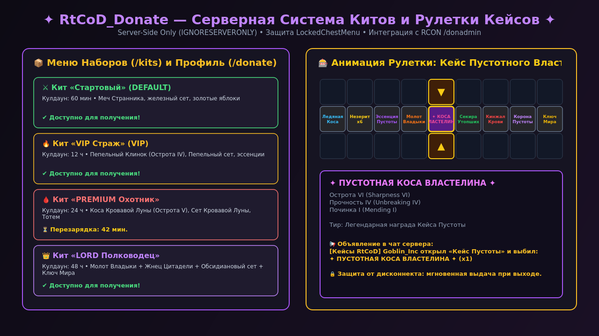

<div align="center">

🌐 **Language:** **English** | [Русский (README_Ru.md)](README_Ru.md)

# 💎 RtCoD Donate (`rtcod_donate`)

**100% Server-Side Only Minecraft Forge 1.20.1 mod providing an interactive donate shop GUI, privilege tiers, `/kits` with cooldowns, and an animated case roulette**

[](https://files.minecraftforge.net/)
[](https://files.minecraftforge.net/)
[](#)
[](https://github.com/Goblin-Inc/RtCoD_Donate/releases)

<br/>



</div>

---

## 📖 Overview

**RtCoD Donate** is a dedicated server-side mod built for the **RtCoD (Return to Chronicles of Darkness)** project on **Minecraft Forge 1.20.1**. It delivers a complete in-game privilege store, `/kits` menu, and animated roulette cases **without requiring players to install the mod on their client** (`displayTest = "IGNORESERVERONLY"`).

All interfaces are powered by a hardened server-side `LockedChestMenu` container (54 slots, `GENERIC_9x6`) that intercepts every inventory interaction (`ClickType.PICKUP`, `QUICK_MOVE`, `SWAP`, `THROW`), completely preventing item duplication or theft of showcase items.

### ✨ Key Features
- **100% Server-Side Only**: works seamlessly with unmodified Forge clients.
- **Animated CS:GO / RPG Case Roulette (`SpinSession`)**:
  - Smooth real-time reward reel animation with progressive deceleration (`tickInterval` scaling from `1` to `10` ticks across 42 steps).
  - Per-step sound effects (`UI_BUTTON_CLICK`), victory fanfare (`PLAYER_LEVELUP` / `UI_TOAST_CHALLENGE_COMPLETE`), and server-wide chat broadcasts when rolling rare relics (`Mythic` / `Void`).
  - Anti-loss protection: if a player closes the inventory mid-spin, the winning reward is still guaranteed to be granted.
- **Deep Integration with `Dying-Realm` (`dying_realm:*`)**: automatically distributes custom staves, Void seals, soul crystals, and relics with graceful fallback to vanilla items if `Dying-Realm` is absent.
- **RCON & Automated Webstore Support**: `/donadmin setrank` and `/donadmin givekey` work directly from the server console or automated webshops (EasyDonate / TradeMC / Tebex / Tydex).

---

## 👑 Ranks & Kits (`/kits`)

| Kit (`ID`) | Required Rank | ⏳ Cooldown | 🎁 Kit Contents |
|:---|:---:|:---:|:---|
| **Starter** (`start`) | `Player` (`default`) | `24 hours` | Iron Sword, Iron Pickaxe, Leather Tunic, 16× Cooked Beef, 8× Torch, 2× Golden Apple |
| **VIP Kit** (`vip`) | `VIP` (`vip`) | `24 hours` | Diamond Sword (Sharpness II), Diamond Chestplate (Protection II), 4× Golden Apple, 8× Ender Pearl, 16× Bottle o' Enchanting |
| **Premium Kit** (`premium`) | `PREMIUM` (`premium`) | `24 hours` | Netherite Sword (Sharpness III), Netherite Chestplate (Protection III), Enchanted Golden Apple, Totem of Undying, 2× Netherite Ingot, `dying_realm:soul_crystal` ×4 |
| **Lord Kit** (`lord`) | `LORD` (`lord`) | `24 hours` | Lord's Netherite Sword (Sharpness V, Fire Aspect II), Full Netherite Armor Set (Protection IV), 3× Enchanted Golden Apple, 2× Totem of Undying, Nether Star, `dying_realm:void_relic` ×2 |

> 💡 **Rank Hierarchy**: `LORD` inherits access to all kits (`lord`, `premium`, `vip`, `start`); `PREMIUM` has access to `premium`, `vip`, `start`; `VIP` has access to `vip` and `start`.

---

## 🎰 Cases & Drop Tables (`/cases`)

| Case (`ID`) | Icon | Description & Reward Pool (with probability weights) |
|:---|:---:|:---|
| **Common Case** (`common`) | `CHEST` | • Diamonds ×8 *(weight 30)*<br>• Emeralds ×16 *(weight 25)*<br>• Golden Apples ×6 *(weight 25)*<br>• Bottles o' Enchanting ×32 *(weight 20)*<br>• Netherite Scrap ×2 *(weight 10)*<br>• Soul Crystal `dying_realm:soul_crystal` ×3 *(weight 12)* |
| **Mythic Case** (`mythic`) | `ENDER_CHEST` | • Netherite Ingot ×2 *(weight 22)*<br>• Totem of Undying *(weight 20)*<br>• Enchanted Golden Apple ×2 *(weight 15)*<br>• Void Netherite Blade (Sharpness V) *(weight 10)*<br>• Void Relic `dying_realm:void_relic` ×2 *(weight 12)*<br>• **VIP** Rank *(weight 4)* |
| **Void Case** (`void`) | `CRYING_OBSIDIAN` | • Nether Star ×2 *(weight 18)*<br>• Enchanted Golden Apple ×5 *(weight 16)*<br>• Void Reaper Scythe (Sharpness VI, Looting IV, Mending) *(weight 8)*<br>• Heart of the Abyss `dying_realm:abyss_heart` *(weight 10)*<br>• **PREMIUM** Rank *(weight 4)*<br>• **LORD** Rank *(weight 2)* |

---

## ⌨️ Commands

### Player Commands
| Command | Description |
|---|---|
| `/donate` | Open the main interactive server menu (profile, ranks, quick links to kits and cases) |
| `/kits` | Open the graphical kits menu displaying availability status and remaining cooldown timers |
| `/kit <start\|vip\|premium\|lord>` | Claim a kit directly into your inventory without opening the GUI |
| `/cases` | Open the cases menu (displays key balances for each tier and starts the roulette on click) |

### Admin & RCON Commands (Permission Level `2+`)
| Command | Description |
|---|---|
| `/donadmin setrank <player> <default\|vip\|premium\|lord>` | Assign a donate rank to a player and persist it in `rtcod_donate_players.json` |
| `/donadmin givekey <player> <common\|mythic\|void> <amount>` | Grant the specified number of case keys to a player |
| `/donadmin resetcooldown <player>` | Immediately reset all `/kit` cooldowns for the specified player |
| `/donadmin info <player>` | Inspect a player's current rank, key balances, and active cooldown timers |

---

## 🏗️ Project Architecture

```
RtCoD_Donate/
├── src/main/java/com/rtcod/donate/
│   ├── RtCoDDonateMod.java       # Mod entry point (IGNORESERVERONLY), command registration, and server ticker
│   ├── DonateCommand.java        # Command handlers for /donate, /kits, /kit, /cases, /donadmin
│   ├── DonateGuiManager.java     # 9x6 showcase builder, click interception, and SpinSession roulette physics
│   ├── DonateData.java           # Rank registry, kits, cases, loot weights, and Dying-Realm item integration
│   ├── LockedChestMenu.java      # Custom ChestMenu preventing any item extraction or slot manipulation
│   └── PlayerDonateStore.java    # Thread-safe JSON store for ranks, keys, and cooldowns in world/
└── build.gradle
```

---

## 🚀 Installation & Build

1. Download the latest `rtcod_donate-1.0.0.jar` from [**Releases**](https://github.com/Goblin-Inc/RtCoD_Donate/releases).
2. Place the `.jar` **into the server's `mods/` folder only** (client installation is not required).
3. All player data is automatically persisted to `world/rtcod_donate_players.json`.

```bash
git clone https://github.com/Goblin-Inc/RtCoD_Donate.git
cd RtCoD_Donate
./gradlew build
```

---

## 📋 Changelog

### `v1.0.0` — Server-Side Donate & Case Roulette Release *(Current)*
- **Added**: `/donate` main menu, `/kits` showcase, and `/cases` roulette built on top of the tamper-proof `LockedChestMenu`.
- **Added**: Animated `SpinSession` case-rolling physics with sound effects and anti-loss protection on window close.
- **Added**: Dynamic integration with `Dying-Realm` items via `ForgeRegistries.ITEMS` with automatic vanilla fallback.
- **Added**: Complete RCON `/donadmin` command suite for automated webstore integration.

---

<div align="center">
Designed for the <b>RtCoD</b> server • Author: <a href="https://github.com/Goblin-Inc">@Goblin-Inc</a> • <a href="README_Ru.md">Русская версия</a>
</div>
